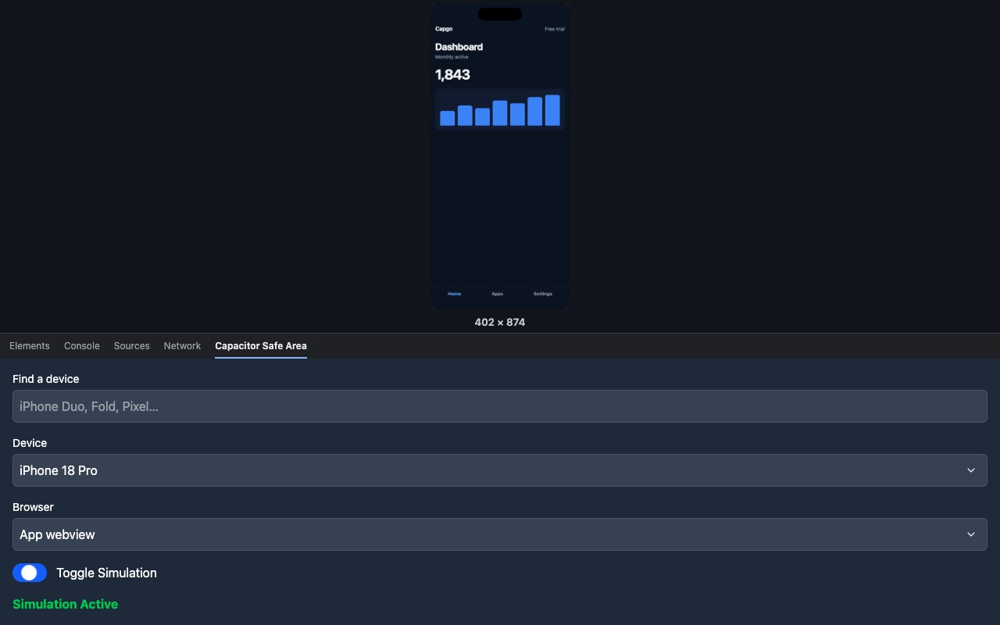
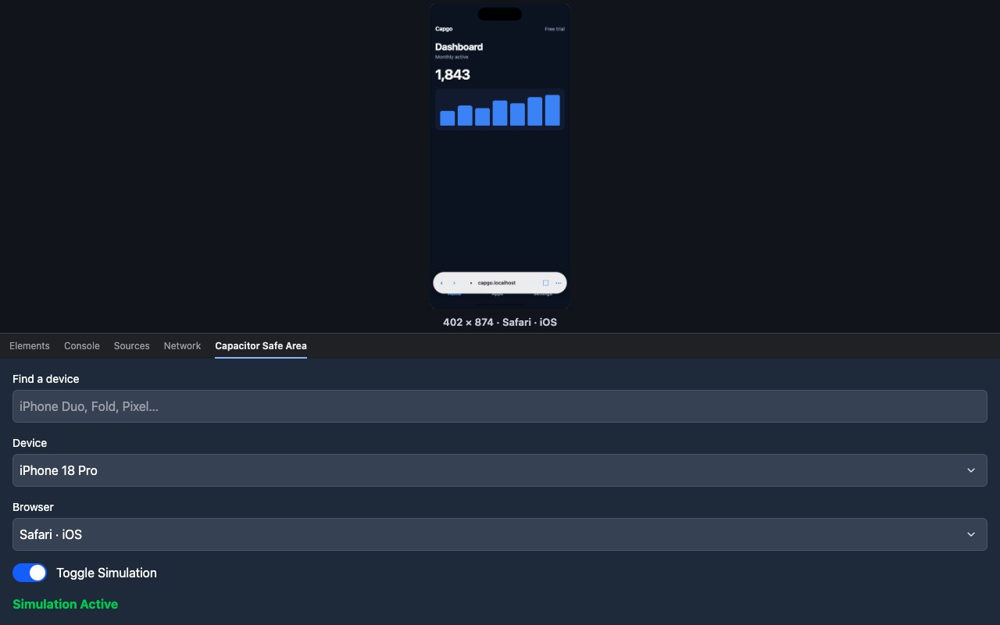
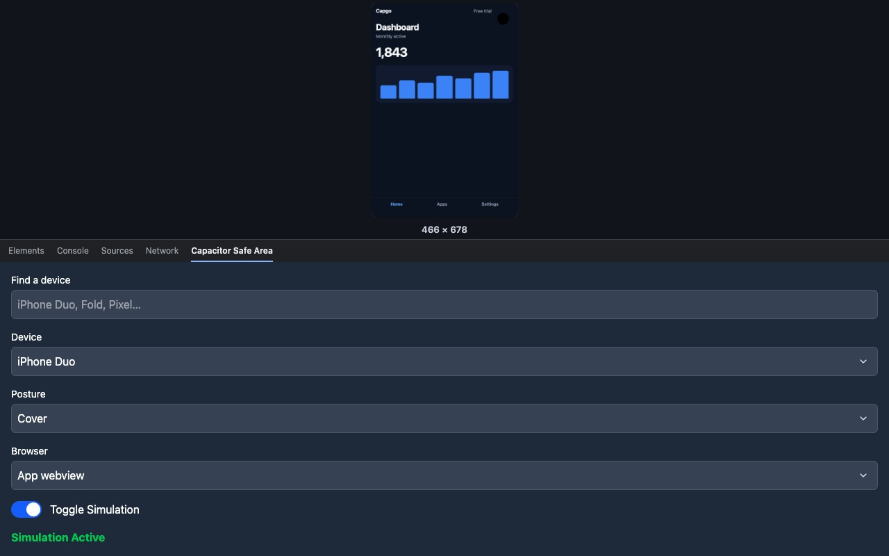
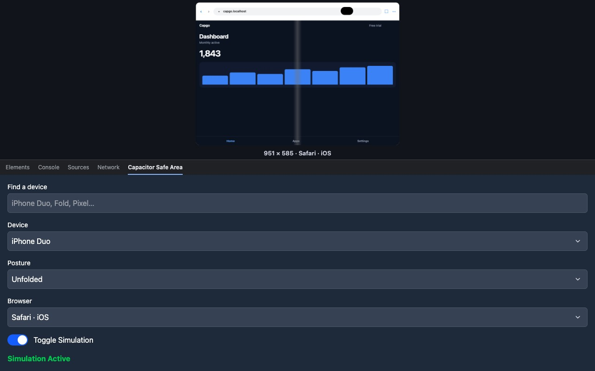
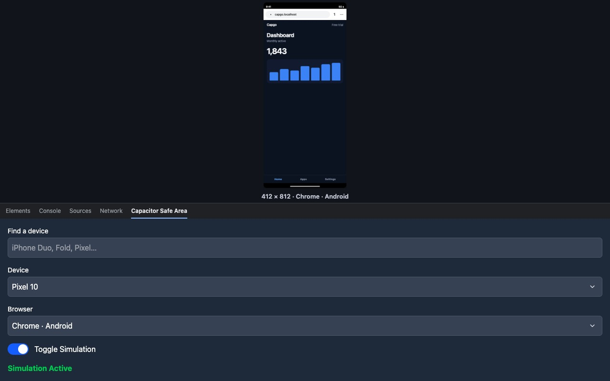

# capacitor-chrome-ext
  
  

  <h2><a href="https://capgo.app/?ref=plugin"> ➡️ Get Instant updates for your App with Capgo</a></h2>

## Chrome Extension

This is a chrome extension that allows you to simulate a real device in your browser. It is useful for testing your capacitor designs on different devices.

### Installation

1. Download the latest release from the [Chrome Store](https://chromewebstore.google.com/detail/capacitor-safe-area-simul/ddaaodgcccedhjbjeollookhompnlfhi?authuser=0&hl=en).

Then open the inspector and click on the tab "Capacitor Safe Area Simulator".

## Screenshots

The small promo tile and the marquee tile are in `store/` as well. The paste-ready Chrome Web Store text is in `store-description.txt`.

## Description

This extension simplify your development process by simulating a real device in your browser. It is useful for testing your capacitor designs on different devices.
Bonus you now don't need to install the capacitor app on your device. And reproduce the same design of your app on your device.

This extension is capable to simulate the safe area of the following frameworks:

- Ionic
- Konsta UI
- Tailwind with plugin Tailwind Capacitor

Ionic, Konsta UI, and Tailwind Capacitor layouts follow the device insets, including pages that read the system safe-area values.

Open the device list in the DevTools panel and pick a phone, tablet, or foldable. Turning the simulation on shows the page at that device's CSS size. The Browser menu can add the bars of Safari, Chrome on iOS, Chrome on Android, Samsung Internet, Opera, or UC Browser. The app webview is the default. Foldables such as iPhone Duo, Galaxy Z Fold 8, Galaxy Z Fold 8 Ultra, Galaxy Z Fold 7, and Pixel 10 Pro Fold have a cover posture and an unfolded posture. The unfolded posture draws the crease separately from the edge insets.

The list also includes the current iPhone 18 Pro, iPhone 17, and iPhone Air line, recent Pixels and Galaxy S phones, iPads, and the older presets from previous versions.

Please contact us if you want to add a device to the list.
